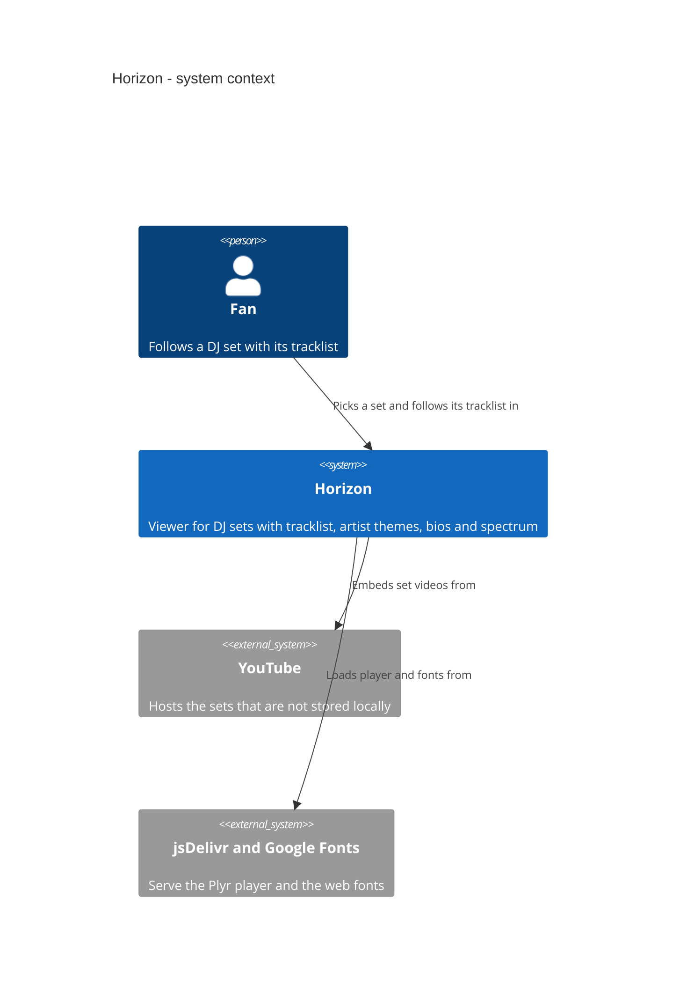

# C4 level 1: system context

Horizon is a personal viewer for DJ sets: a fan picks a set, watches it (local video or YouTube) and follows its tracklist, with an artist theme, a bio and a live audio spectrum.

