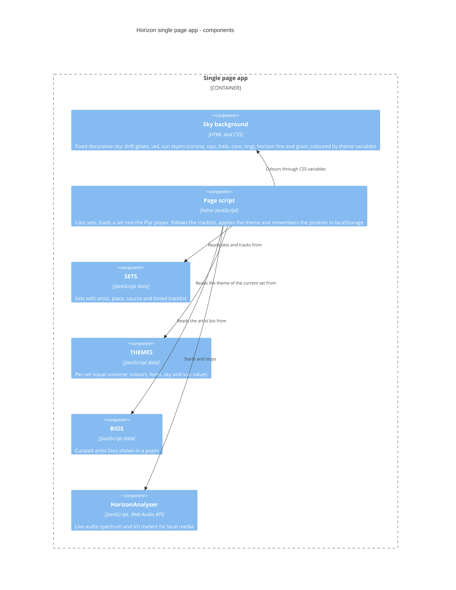

# C4 level 3: components

The single page app is one HTML page whose inline script drives the player and tracklist; data and visuals come from plain scripts that set globals on `window`. `serve.py` is a single module with no components of its own.

| Component | Path | Responsibility |
| --- | --- | --- |
| Sky background | `index.html` (`.sky` markup and its CSS) | Decorative animated sky and sun behind the page, coloured by theme variables |
| Page script | `index.html` (inline `<script>`) | Set list, player, tracklist, theme switching, resume position |
| SETS | `sets.js` | Set data and timed tracklists |
| THEMES | `themes.js` | Per-set colours, fonts and sky/sun values |
| BIOS | `bios.js` | Artist bios |
| HorizonAnalyser | `analyser.js` | Audio spectrum and VU meters |
